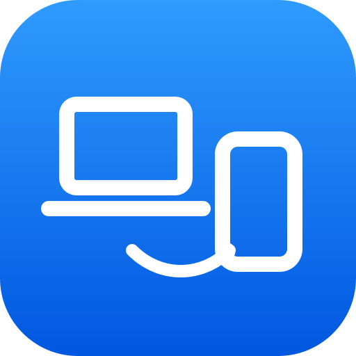
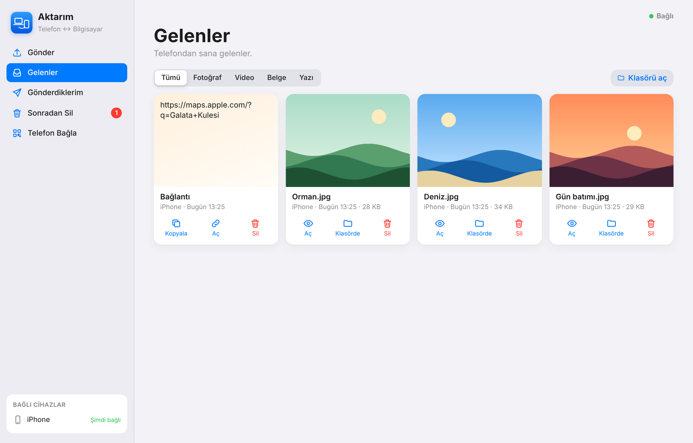
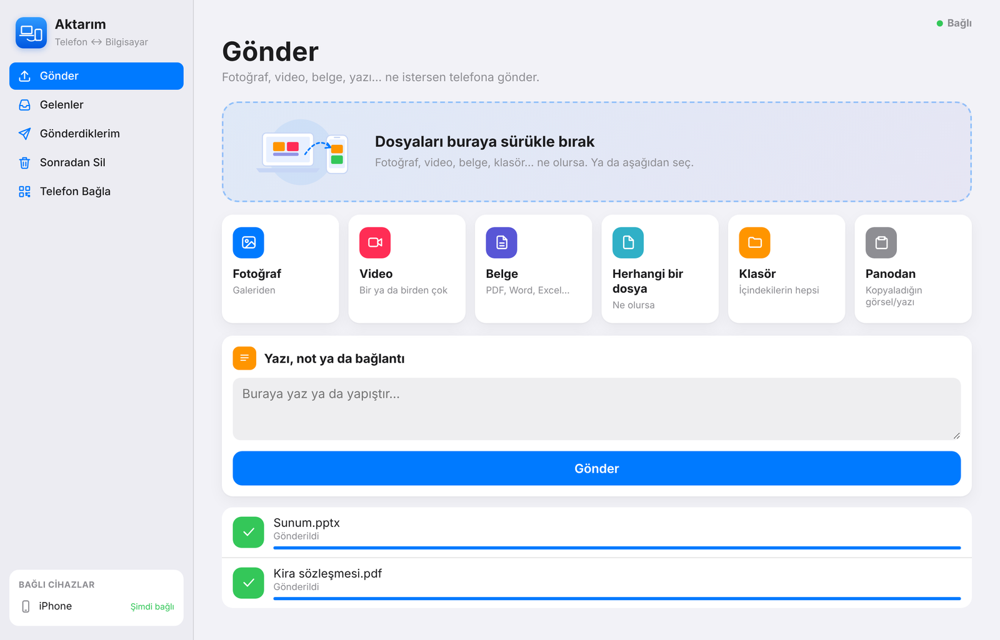
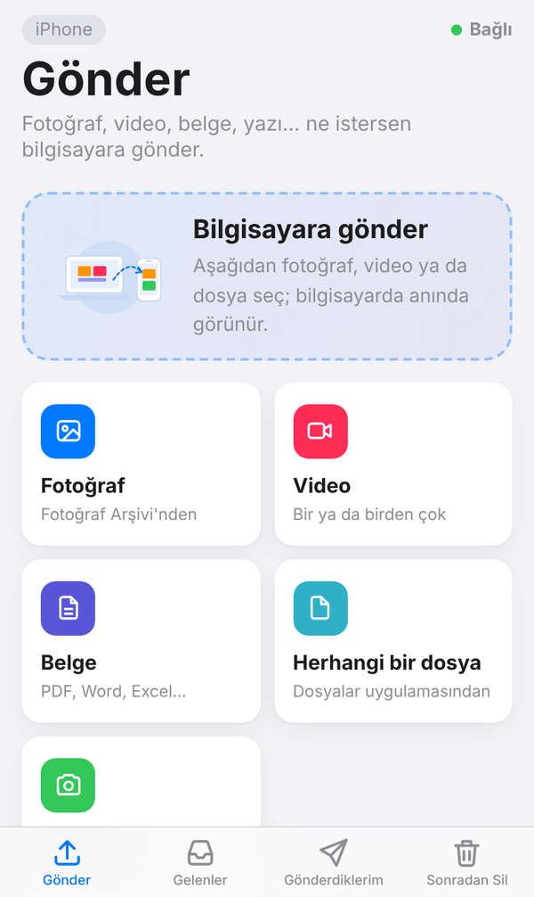
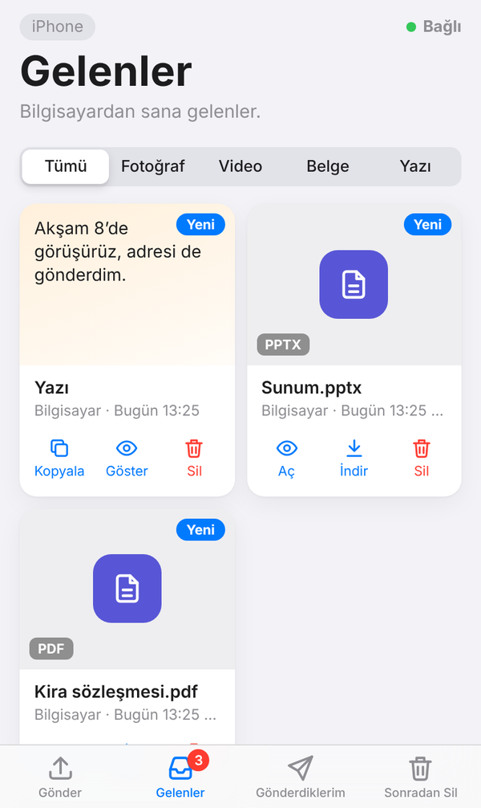
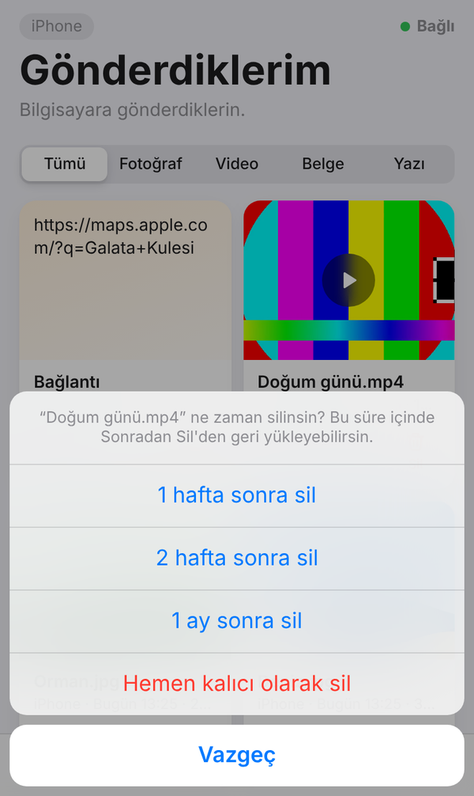
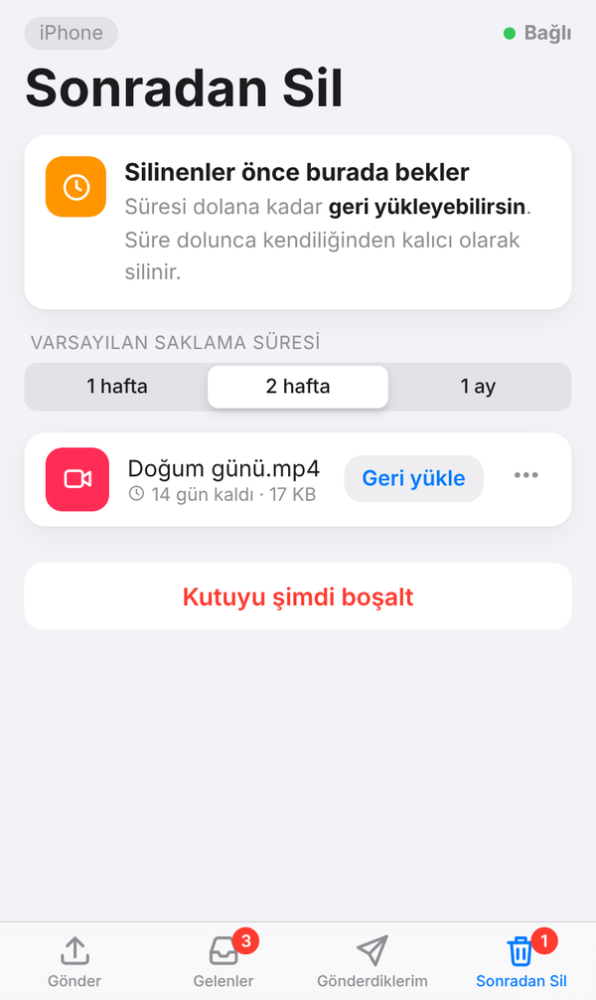
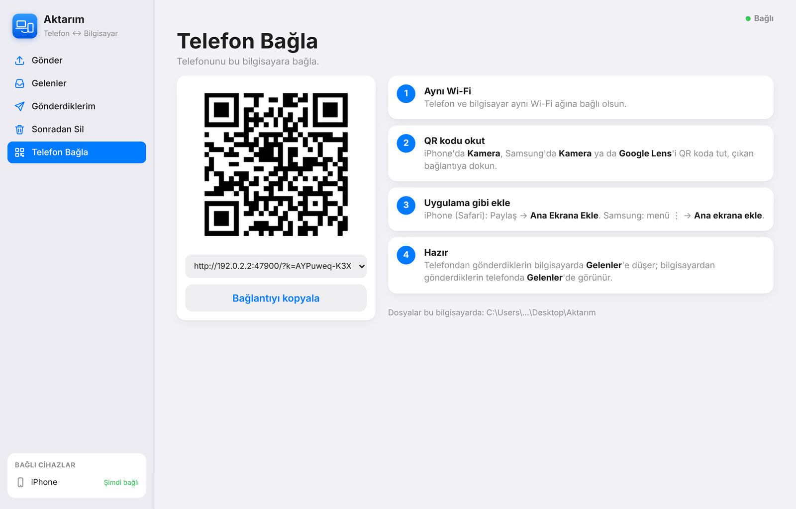

<p align="center"></p>
<h1 align="center">Aktarım</h1>
<p align="center"><b>Bilgisayarınla telefonun arasında fotoğraf, video, belge, yazı… ne varsa gönder ve al.</b><br>
iPhone ve Samsung (Android) ile çalışır · telefona uygulama yüklemek gerekmez · her şey evdeki ağda kalır</p>

<p align="center"></p>

## Ne yapar?

| | |
|---|---|
| **Gönder** | Fotoğraf, video, belge, klasör, yazı ya da bağlantıyı pencereye sürükle bırak; telefonda anında görünür. |
| **Gelenler** | Telefondan gönderdiklerin bilgisayarda **Gelenler**'e düşer, saat yanında bildirim çıkar. Dosyalar `Masaüstü\Aktarım\Gelenler` klasörüne gerçek adlarıyla kaydedilir. |
| **Gönderdiklerim** | Karşı tarafa gönderdiğin her şey. |
| **Sonradan Sil** | Sildiğin öğe hemen gitmez: **1 hafta**, **2 hafta** ya da **1 ay** bekler, bu sürede **geri yükleyebilirsin**. Süre dolunca kendiliğinden silinir. |
| **Telefon Bağla** | QR kodu telefonun kamerasıyla okut, bağlan. |

<p align="center">
  
</p>

### Telefonda

<p align="center">
  
  
  
  
</p>

## Kurulum (Windows 10 / 11)

1. Başlat menüsüne **PowerShell** yaz, **Windows PowerShell**'i aç.
2. Aşağıdaki satırı kopyalayıp pencereye yapıştır, **Enter**'a bas:

   ```
   irm https://raw.githubusercontent.com/bdenizkarakoc/Aktarim/main/Kur.ps1 | iex
   ```
3. Yönetici izni sorulunca **Evet** de.

Bu kadar. Aktarım **`C:\Program Files\Aktarim`** klasörüne kurulur ve kendi penceresinde açılır:

- **Başlat menüsünde** ve **masaüstünde** *Aktarım* simgesi olur,
- **saat yanında** simgesi durur (tıklayınca açılır; sağ tıkla klasörleri aç ya da kapat),
- Windows açılınca arka planda kendiliğinden başlar, telefonun her zaman gönderebilir,
- dosyaya sağ tık → **Gönder** → *Telefona gönder (Aktarım)*,
- **Ayarlar → Uygulamalar**'dan kaldırılabilir (aktarılan dosyaların silinmez).

Güncellemek için aynı satırı yeniden çalıştırman yeterli.

<p align="center"></p>

## Telefonu bağlamak

1. Telefon ile bilgisayar **aynı Wi-Fi**'ye bağlı olsun.
2. Aktarım'da **Telefon Bağla**'yı aç, QR kodu telefonun **Kamera**sıyla okut (Samsung'da Kamera ya da Google Lens).
3. Açılan sayfayı uygulama gibi ekle: iPhone'da Safari → Paylaş → **Ana Ekrana Ekle**; Samsung'da menü → **Ana ekrana ekle**.

**Bağlanmıyorsa:** Windows'ta Wi-Fi ağının **Özel** ağ olarak ayarlı olduğundan emin ol (Ayarlar → Ağ ve İnternet → Wi-Fi → ağ adı → *Özel ağ*).

## Fotoğraf ve videolar doğrudan galeriye

- **Samsung / Android:** Gelenler'de **Galeriye**'ye dokun (ya da *Hepsini Galeri'ye kaydet*); fotoğraf ve video
  **Galeri → İndirilenler** albümüne iner.
- **iPhone:** Gelenler'de **Kaydet** → **Görüntüyü Kaydet / Videoyu Kaydet**: doğrudan **Fotoğraflar**'a (Film Rulosu) iner;
  *Hepsini Fotoğraflar'a kaydet* ile hepsi birden. iPhone bunu yalnızca güvenli bağlantıda yaptığı için ilk seferde
  Aktarım 1 dakikalık bir kurulum gösterir: sertifikayı indir → Ayarlar'da **Profil İndirildi → Yükle** →
  **Genel → Hakkında → Sertifika Güven Ayarları → Aktarim Yerel CA**'yı aç. Sonra Aktarım kendiliğinden güvenli
  bağlantıya geçer. (Sertifika bu bilgisayarda üretilir, yalnızca Aktarım için ve yalnızca evdeki ağda kullanılır.)

## Bilmen gerekenler

- Her şey yalnızca evdeki ağda kalır, internete bir şey yüklenmez. QR koddaki bağlantı gizli bir anahtar içerir; o bağlantı olmadan kimse göremez.
- AirDrop yalnızca Apple cihazları arasında çalıştığı için Aktarım telefonda tarayıcı üzerinden çalışır; böylece iPhone'da da Samsung'da da aynıdır.
- Aktarım kendi kapısını (47800) kullanır; bilgisayardaki başka programlarla (ör. Reels Fabrikası) karışmaz.

---

<details><summary>Geliştiriciler için</summary>

- `Aktarim.ps1` — Windows uygulaması (PowerShell 5.1; saat yanında simge, Edge/Chrome uygulama penceresi), `Aktarim.vbs` onu pencere açmadan başlatır.
- `aktarim.py` — aynı API ile Python sürümü (macOS/Linux, yalnızca standart kitaplık).
- `web/` — arayüz. `Kur.ps1` / `Kaldir.ps1` — kurulum ve kaldırma.
- Testler: `python -m pytest tests -q`
</details>
